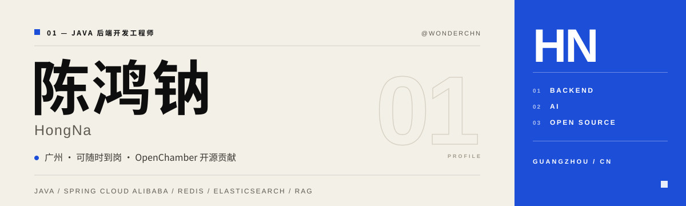

  

  <h2>Hi, I'm HongNa 👋</h2>
  
Java backend engineer based in Guangzhou, focused on AI application engineering.

  
用代码解决问题，也把实践过程认真记录下来。

  

    <a href="https://www.cnblogs.com/xiaochenNN/">技术博客</a>
    ·
    <a href="https://github.com/Wonderchn?tab=repositories">公开项目</a>
    ·
    <a href="https://github.com/Wonderchn/Wonderchn/issues/new">找我交流</a>
  

---

### 关于我

- Java 后端开发工程师，关注高并发一致性、数据权限与 AI 应用工程化。
- 有政务、集团 OA 与档案系统开发经验，负责绩效考核、用户中心、数据权限与文件检索等核心模块。
- 目前在广州，可随时到岗。
- 在 [博客园](https://www.cnblogs.com/xiaochenNN/) 记录技术学习与实际问题的解决过程。
- 工作之外喜欢足球、阅读，也珍惜和重要的人相处的时间。

### 技术栈

- **后端框架：**Java · Spring Boot · Spring Cloud Alibaba（Nacos / Gateway / Sentinel / Seata）· MyBatis-Plus
- **数据与文件：**MySQL · PostgreSQL · Oracle · Redis / Redisson · Elasticsearch · Flink CDC · MinIO
- **权限与业务：**Spring Security / OAuth2 · Sa-Token · RBAC · AOP 数据权限 · SM2 / SM4 · Flowable · EasyExcel
- **AI 与工程：**AgentScope · RAG · SSE · MCP · Vue 3 / Element Plus · Git · Docker · GitHub Actions · SkyWalking / MDC · Filebeat / Logstash

### 代表项目

- **[Ruoyi-Ai-AgentScope](https://github.com/Wonderchn/Ruoyi-Ai-AgentScope)** — 多租户 AI 应用平台：多租户授权、RAG 知识库问答、Outbox 任务恢复与 SSE 流式交付。

### 开源贡献

- **[openchamber/openchamber #4965](https://github.com/openchamber/openchamber/pull/4965)** — 提交并已合入上游的 TypeScript 修复：保存的工作目录失效后，供应商与模型设置会持续加载失败；增加目录可用性探测、回退与并发竞态保护，补充 7 项回归测试。

### 技术写作

- [分片上传与断点续传实现详解](https://www.cnblogs.com/xiaochenNN/p/19166595) — 从分片、进度记录到中断恢复。
- [RuoYi-Cloud-Plus 数据权限实现原理解析](https://www.cnblogs.com/xiaochenNN/p/19166016) — 梳理 AOP、MyBatis 拦截器与数据范围控制。

更多内容见 [技术博客](https://www.cnblogs.com/xiaochenNN/)。
